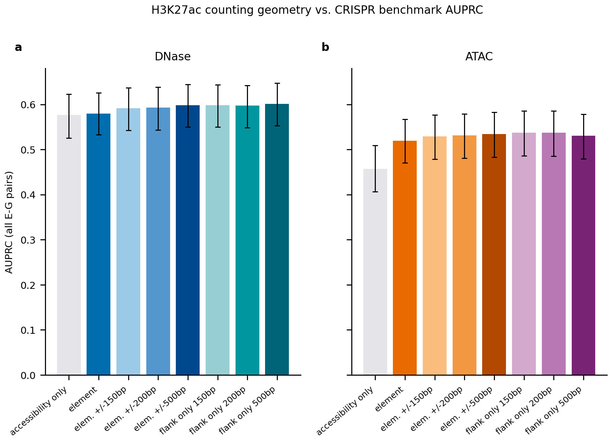
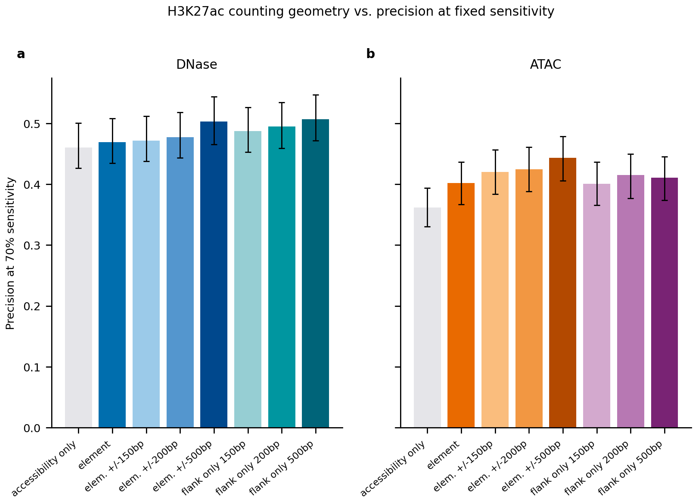
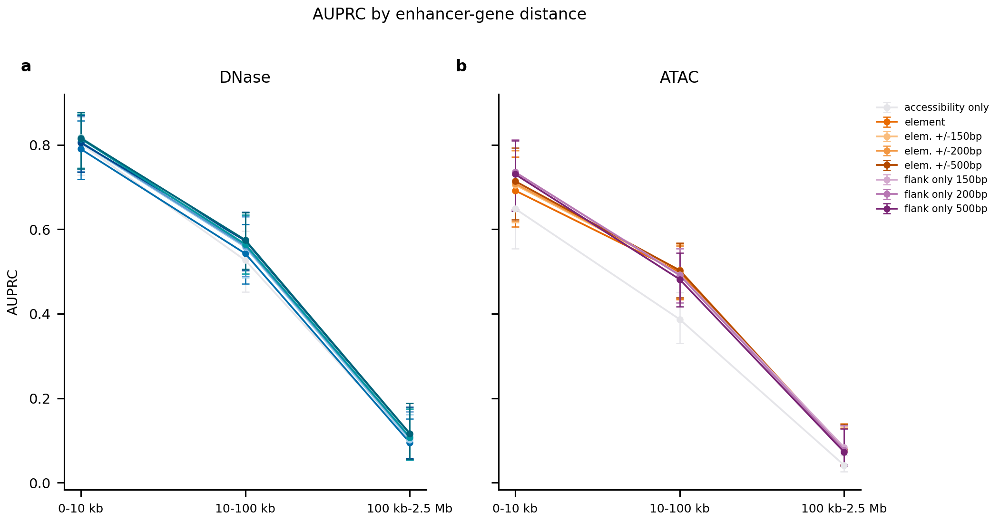

<style>
body, p, li, td, th, summary, div {
  font-family: -apple-system, "Segoe UI", Roboto, Helvetica, Arial, sans-serif;
}
h1, h2, h3, h4, h5, h6 {
  font-family: -apple-system, "Segoe UI", Roboto, Helvetica, Arial, sans-serif;
}
code, pre {
  font-family: "SFMono-Regular", Consolas, "Liberation Mono", Menlo, monospace;
}
</style>

## Headline figure



**Figure 1 | H3K27ac counting geometry vs. CRISPR benchmark AUPRC.** AUPRC
(area under the precision-recall curve) against the K562 ENCODE CRISPR
enhancer-gene benchmark (n = 466 positive, 9,876 negative element-gene
pairs), for eight H3K27ac counting variants layered on (**a**) DNase or
(**b**) ATAC accessibility. Bars: mean AUPRC; error bars: 95% CI (bootstrap,
CRISPR_comparison pipeline default). Colors distinguish counting families:
grey = accessibility alone (no H3K27ac); blue/orange ramp = element extended
symmetrically by the flank width (element +/-N bp); teal/purple ramp =
flanks only, excluding the element itself. Darker shade = wider flank.
Quantile normalization was off for all runs (single cell type; see Methods).
**Headline figure.**

## Summary

- Every H3K27ac counting variant beats accessibility alone, but the margin
  is far bigger for ATAC (AUPRC 0.457 -> 0.52-0.54, Fig. 1b) than for DNase
  (0.576 -> 0.58-0.60, Fig. 1a) — H3K27ac adds much less new information on
  top of DNase than on top of ATAC in this benchmark.
- Within the H3K27ac variants, flank-only and element+-flank counting both
  edge out plain element counting (best DNase AUPRC 0.601 vs. 0.579; best
  ATAC AUPRC 0.537 vs. 0.519, Fig. 1), but every variant's 95% CI overlaps
  every other variant's — none of these pairwise differences is resolved by
  this benchmark's sample size.
- Flank width (150 vs. 200 vs. 500 bp) makes almost no difference on its
  own: within either counting family, AUPRC changes by <=0.01 across the
  three widths (Fig. 1), well inside the CI width of ~0.05.
- The flank-counting advantage over element-only counting is concentrated
  at 10-100 kb enhancer-gene distance for both assays (Fig. 3); at <10 kb it
  nearly vanishes, and at >100 kb all variants converge to low AUPRC with
  wide, overlapping CIs from small positive counts (n = 82).

## Goals

Test whether counting H3K27ac ChIP-seq reads over a symmetric flank around
each candidate element (element +/-N bp), or over the flanks alone
(excluding the element), changes ABC prediction accuracy relative to the
pipeline's current element-only counting — and whether the answer depends
on flank width (150/200/500 bp) or on which accessibility assay (DNase vs.
ATAC) defines the candidate elements.

## Flank-based counting nudges AUPRC up for both assays, but not past the noise floor

**Q:** Does extending H3K27ac counting into the flanks (or restricting it to
the flanks) change AUPRC against the CRISPR benchmark, for all
element-gene pairs?

**A:** Every flank-based variant scores numerically above plain element
counting for both assays (best DNase AUPRC 0.601 vs. 0.579; best ATAC AUPRC
0.537 vs. 0.519), but the 95% CIs of all eight variants overlap heavily
within each assay (Fig. 1).


<details>
<summary>Figure 1 legend (repeated)</summary>

**Figure 1 | H3K27ac counting geometry vs. CRISPR benchmark AUPRC.** See
headline legend above for full details. n = 466 positive / 9,876 negative
pairs per assay (same experimental data, K562 ENCODE CRISPR ensemble
benchmark, in both panels).
</details>

**Method.**

- ABC predictions run once per counting variant (12-16 K562 biosample
  combinations: 2 assays x {accessibility-only, element, element+-flank at
  150/200/500 bp, flank-only at 150/200/500 bp}), qnorm off.
- Benchmarked against `EPCrisprBenchmark_ensemble_data_GRCh38.tsv.gz` via
  the CRISPR_comparison pipeline (`comparePredictionsToExperiment.Rmd`),
  split into separate DNase-only and ATAC-only comparisons.
- AUPRC and its 95% CI come directly from
  `performance_summary.txt` in each comparison's results directory.

<details>
<summary>Full methods &amp; code</summary>

Read `performance_summary.txt` from
`CRISPR_comparison/workflow/results/2026_0721_h3k27ac_counting_{DHS,ATAC}/`,
one row per predictor (`AUPRC`, `AUPRC_lowerCi`, `AUPRC_upperCi`). Bar colors
reused directly from `resources/pred_config/pred_config_h3k27ac_counting_{DHS,ATAC}.tsv`
so this figure's palette matches the source CRISPR_comparison HTML reports.

```bash
python analysis/h3k27ac_counting_report/make_figures.py     # M1: regenerate fig 1-3
```
Source: `analysis/h3k27ac_counting_report/make_figures.py -> fig_auprc()`
</details>

## The precision gain at fixed sensitivity is largest for element+-500bp on ATAC, flank-only-500bp on DNase

**Q:** At a fixed 70% sensitivity, does precision (fraction of predicted
pairs that are true positives) follow the same ranking as AUPRC?

**A:** Mostly yes, but not exactly: DNase's best precision is flank-only
500 bp (0.507 vs. 0.469 for element), while ATAC's best precision is
element +/-500 bp (0.444 vs. 0.402 for element) — the AUPRC-best ATAC
variant (flank-only 150 bp, precision 0.401) is not the precision-best one.



<details>
<summary>Figure 2 legend</summary>

**Figure 2 | H3K27ac counting geometry vs. precision at fixed sensitivity.**
Precision at the sensitivity threshold used by the CRISPR_comparison
pipeline (70%), for the same eight counting variants and n as Fig. 1, for
(**a**) DNase and (**b**) ATAC. Bars: point estimate; error bars: 95% CI.
Same color scheme as Fig. 1.
</details>

**Method.**

- `PrecMinSens` / `PrecMinSens_lowerCi` / `PrecMinSens_upperCi` columns from
  the same `performance_summary.txt` files as Fig. 1.

<details>
<summary>Full methods &amp; code</summary>

`PrecMinSens` is the precision at the score threshold that achieves at
least 70% sensitivity on the full pair set (`min_sensitivity: 0.7` in
`config_h3k27ac_counting.yml`), computed once per predictor by
`comparePredictionsToExperiment.Rmd`.

```bash
python analysis/h3k27ac_counting_report/make_figures.py     # M1: regenerate fig 1-3
```
Source: `analysis/h3k27ac_counting_report/make_figures.py -> fig_precision()`
</details>

## The flank-counting advantage is concentrated at 10-100kb enhancer-gene distance

**Q:** Does the small AUPRC advantage of flank-based counting hold at every
enhancer-gene distance, or is it distance-dependent?

**A:** The gap between element-only and the best flank variant is small at
<10 kb (DNase 0.790 vs. 0.818 AUPRC) and widens in relative terms at
10-100 kb (DNase 0.543 vs. 0.575; ATAC 0.499 vs. 0.504), before all variants
converge to low AUPRC with wide, overlapping CIs beyond 100 kb (n = 82
positives).



<details>
<summary>Figure 3 legend</summary>

**Figure 3 | AUPRC by enhancer-gene distance.** AUPRC (y-axis) for each of
the eight H3K27ac counting variants, stratified into three enhancer-gene
distance bins (0-10 kb: n = 132 pos / 90 neg; 10-100 kb: n = 252 pos / 1,341
neg; 100 kb-2.5 Mb: n = 82 pos / 8,445 neg), for (**a**) DNase and
(**b**) ATAC. Points: mean AUPRC; error bars: 95% CI. Same color scheme as
Fig. 1; legend in panel b applies to both panels. Distance bins and n's from
`dist_bins_kb: [0, 10, 100, 2500]` in `config_h3k27ac_counting.yml`.
</details>

**Method.**

- Distance bins and per-bin AUPRC + CI from
  `performance_summary_distance_binned.txt` (metric == `auprc`, `subset !=
  "All"`) in each comparison's results directory.

<details>
<summary>Full methods &amp; code</summary>

Enhancer-gene distance is `distToTSS`, binned by the CRISPR_comparison
pipeline into `[0,10)`, `[10,100)`, `[100,2500)` kb. AUPRC and its 95% CI are
computed independently within each bin (same bootstrap procedure as the
overall AUPRC).

```bash
python analysis/h3k27ac_counting_report/make_figures.py     # M1: regenerate fig 1-3
```
Source: `analysis/h3k27ac_counting_report/make_figures.py -> fig_distance()`
</details>

## Open questions / next steps

- None of the element-vs-flank or flank-width comparisons clears its own
  95% CI — is a larger CRISPR benchmark (more E-G pairs, or a
  cross-dataset combination) needed to resolve whether flank-based counting
  is a real improvement, or is the true effect simply this small?
- DNase and ATAC disagree on which flank family wins on precision
  (flank-only for DNase, element+-flank for ATAC) — worth checking whether
  this is noise or reflects a real difference in how the two assays'
  candidate regions interact with flanking H3K27ac signal.
- The 100 kb-2.5 Mb bin has only 82 positives across both assays; any
  distance-dependence claim there should be treated as exploratory only.
- [Q for Jesse/lab] Given the gains are within noise, is it worth adopting
  flank-based H3K27ac counting as a pipeline default, or keeping
  element-only until a larger benchmark can resolve the comparison?

## Methods

Quantile normalization (`use_qnorm`) was off for every run in this
comparison. Qnorm exists to make signal comparable *across* cell types by
mapping each sample's distribution onto a K562 reference; since every
biosample here already is K562, and that reference was itself built
assuming element-only counting, applying it here would have confounded the
comparison between counting geometries. `alpha` (the plotted score cutoff)
was correspondingly left blank for all H3K27ac-variant predictors in
`pred_config_h3k27ac_counting_{DHS,ATAC}.tsv` — the pre-calibrated
`abc_thresholds.tsv` values assume qnorm'd data and would be misleading
here. All comparisons therefore rest on the continuous `ABC.Score` (AUPRC,
precision-recall), not any binary threshold.

### Regenerate

```bash
# 1. ABC predictions (12 base + 4 additional 500bp-flank biosamples), from
#    ABC-Enhancer-Gene-Prediction/:
sbatch config/mine/submit_h3k27ac_counting.sbatch

# 2. CRISPR benchmark (split DNase/ATAC comparisons), from
#    CRISPR_comparison/workflow/ :
sbatch submit_h3k27ac_counting.sbatch

# 3. This report's figures, from ABC-Enhancer-Gene-Prediction/:
python analysis/h3k27ac_counting_report/make_figures.py

# 4. Render:
python /oak/stanford/groups/engreitz/Users/sheth/EngreitzLabAgents/skills/analysis-report/render_report.py \
    analysis/h3k27ac_counting_report/h3k27ac_counting_report.qmd
```
